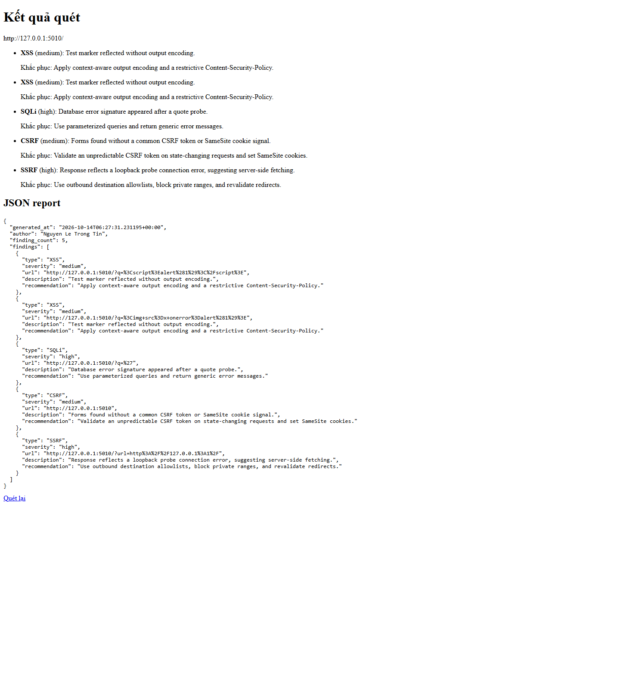
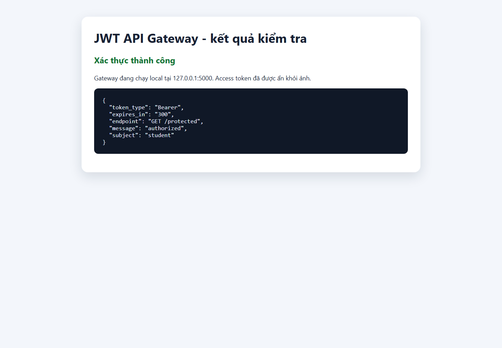
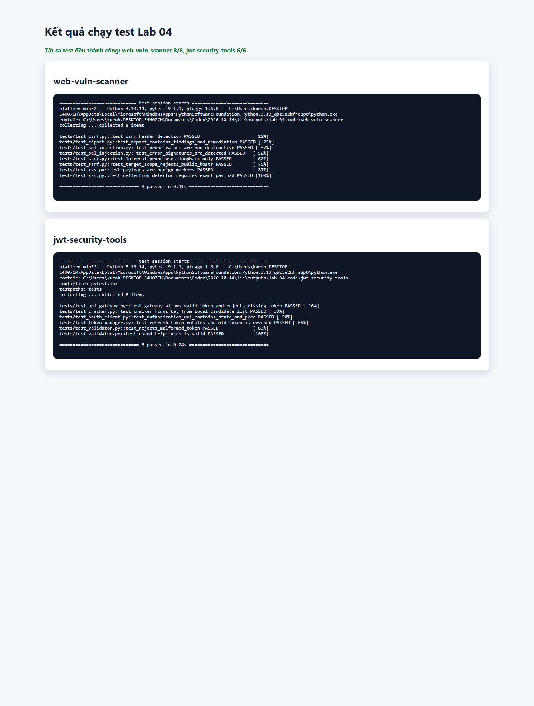

# Buổi 4 – Lab 04: Web Vulnerability Scanner và JWT Security Tools

- **Sinh viên:** Nguyen Le Trong Tin
- **MSSV:** 2387700068
- **Môn học:** Thực hành Lập trình An toàn Thông tin
- **Phạm vi:** Tuần 4 – gồm đúng hai project của Lab 04.

Buổi 4 gồm hai chương trình Python độc lập. `web-vuln-scanner` kiểm tra một số dấu hiệu lỗ hổng trên ứng dụng web trong lab được phép. `jwt-security-tools` thực hành xác thực JWT, quản lý token, OAuth PKCE và API gateway chạy cục bộ. Mỗi project có thư mục, dependency, lệnh chạy và bộ kiểm thử riêng.

## Cấu trúc thư mục Buổi 4

```text
Buoi 4/
├── README.md
├── images/
│   ├── web-vuln-scanner-result.png
│   ├── jwt-api-result.png
│   └── lab-04-test-results.png
├── web-vuln-scanner/
│   ├── main.py
│   ├── requirements.txt
│   ├── scanners/
│   ├── report/
│   ├── ui/
│   └── tests/
└── jwt-security-tools/
    ├── main.py
    ├── requirements.txt
    ├── api_gateway/
    ├── jwt_validator/
    ├── jwt_cracker/
    ├── oauth_client/
    ├── token_manager/
    └── tests/
```

Hai project có virtual environment riêng để tránh xung đột thư viện. Trên Windows, mở PowerShell tại thư mục repository đã clone. Kiểm tra Python trước:

```powershell
py --version
```

Nếu lệnh `py` không có trên máy, dùng `python --version` và thay `py` bằng `python` trong các lệnh tạo môi trường bên dưới. Chạy từng lệnh một, đợi lệnh hoàn tất rồi mới chạy lệnh tiếp theo. Không chạy lệnh trong `C:\Windows\System32`.

## Project 1: Web Vulnerability Scanner

### Mục tiêu và thành phần

Scanner gửi các request kiểm tra giới hạn tới URL mục tiêu trong lab và tìm tín hiệu phổ biến. Đây là công cụ minh họa học tập, không phải trình quét toàn diện hay kết luận xác nhận lỗ hổng.

| Thành phần | Vai trò |
| --- | --- |
| `main.py` | Chạy scanner từ command line, phối hợp bốn bộ kiểm tra và lưu báo cáo JSON. |
| `scanners/xss_scanner.py` | Gửi hai chuỗi marker XSS vào tham số `q`, kiểm tra marker có được phản chiếu nguyên dạng trong HTML. |
| `scanners/sql_injection_tester.py` | Gửi một số ký tự dấu nháy vào `q`, dò các thông báo lỗi cơ sở dữ liệu phổ biến. |
| `scanners/csrf_detector.py` | Tìm form HTML và một số tín hiệu bảo vệ CSRF thông thường như token hoặc cookie SameSite. |
| `scanners/ssrf_tester.py` | Gửi giá trị URL loopback thử nghiệm vào tham số `url`, tìm dấu hiệu lỗi fetch được phản hồi trả lại. |
| `scanners/scope.py` | Giới hạn mục tiêu mặc định vào localhost/loopback; domain khác cần được cho phép bằng cấu hình. |
| `report/report_generator.py` | Tạo báo cáo JSON gồm thời điểm, tác giả, số lượng và danh sách phát hiện. |
| `ui/app.py` | Giao diện Flask tại `http://127.0.0.1:5001`. |
| `tests/` | Kiểm tra hành vi các scanner, giới hạn phạm vi và báo cáo. |

Phát hiện chỉ là **tín hiệu cần kiểm tra thủ công**. Phản chiếu chuỗi không tự chứng minh khai thác XSS; thông báo lỗi không tự chứng minh SQL injection; thiếu tín hiệu CSRF được kiểm tra không chứng minh ứng dụng chắc chắn lỗi.

### Cài đặt trên Windows PowerShell

Từ thư mục repository:

```powershell
cd ".\Buoi 4\web-vuln-scanner"
py -m venv .venv
.\.venv\Scripts\python.exe -m pip install -r requirements.txt
```

Nếu `py -m venv .venv` báo lỗi, xác nhận đã cài Python và bật lựa chọn **Add Python to PATH**, đóng/mở lại PowerShell, kiểm tra `py --version`, sau đó thử lại. Nếu không tạo được `.venv`, không chạy các lệnh `\.venv\Scripts\python.exe`; xử lý bước tạo môi trường trước.

### Chạy giao diện web

```powershell
.\.venv\Scripts\python.exe -m ui.app
```

Giữ cửa sổ PowerShell này chạy. Mở trình duyệt tại <http://127.0.0.1:5001>. Nhập địa chỉ ứng dụng lab đang chạy trên localhost, sau đó bấm nút quét. Scanner chỉ cho phép localhost/loopback theo mặc định. Khi hoàn tất, trang hiển thị các tín hiệu và báo cáo JSON. Nhấn `Ctrl+C` ở PowerShell để dừng server.

### Chạy CLI

Từ thư mục `web-vuln-scanner`, thay URL bên dưới bằng ứng dụng lab cục bộ hoặc mục tiêu bạn có văn bản cho phép kiểm thử:

```powershell
.\.venv\Scripts\python.exe .\main.py http://127.0.0.1:PORT/ --output .\report.json
```

Thay `PORT` bằng cổng ứng dụng lab, ví dụ `5000`. Sau khi chạy, `report.json` được tạo tại thư mục hiện hành. Có thể xem nội dung bằng:

```powershell
Get-Content .\report.json
```

Để kiểm tra domain ngoài localhost được cấp phép rõ ràng, chỉ thêm hostname được phép trong phiên PowerShell hiện tại:

```powershell
$env:LAB_ALLOWED_HOSTS = 'lab.example.edu'
```

Thay `lab.example.edu` bằng hostname thực sự được cho phép. Không đưa danh sách mục tiêu nội bộ, thông tin đăng nhập hay dữ liệu nhạy cảm vào repository. Đóng cửa sổ PowerShell sẽ xóa biến môi trường tạm này.

## Project 2: JWT Security Tools

### Mục tiêu và thành phần

| Thành phần | Vai trò |
| --- | --- |
| `main.py` | Cung cấp các chế độ chạy gateway, kiểm tra token và kiểm tra khóa ứng viên offline có giới hạn. |
| `jwt_validator/validator.py` | Xác minh chữ ký HS256 và thời hạn `exp`; trả claims khi token hợp lệ. |
| `jwt_cracker/cracker.py` | Thử danh sách ứng viên cục bộ với token sở hữu trong lab; giới hạn tối đa 1.000 ứng viên. |
| `oauth_client/client.py` | Tạo URL OAuth Authorization Code với PKCE S256 và `state`; hỗ trợ đổi authorization code. |
| `token_manager/manager.py` | Phát hành access/refresh token và quản lý refresh token trong bộ nhớ. |
| `api_gateway/gateway.py` | Gateway Flask chỉ lắng nghe tại `127.0.0.1:5000`, có endpoint cấp token, refresh và protected. |
| `tests/` | Kiểm tra validator, token manager, gateway, OAuth PKCE và giới hạn kiểm tra khóa. |

Gateway dùng tài khoản demo trong mã nguồn (`student` / `lab-password`) nên chỉ để thực hành cục bộ; không dùng làm xác thực cho dịch vụ thật. Refresh token lưu trong RAM và mất khi tiến trình dừng.

### Cài đặt trên Windows PowerShell

Mở PowerShell mới (hoặc về repository root), rồi chạy:

```powershell
cd ".\Buoi 4\jwt-security-tools"
py -m venv .venv
.\.venv\Scripts\python.exe -m pip install -r requirements.txt
```

### Tạo khóa lab và khởi động API

Trong PowerShell ở thư mục `jwt-security-tools`, tạo khóa ngẫu nhiên riêng cho lần chạy này rồi khởi động gateway:

```powershell
$env:JWT_SECRET = [Convert]::ToBase64String([Security.Cryptography.RandomNumberGenerator]::GetBytes(32))
.\.venv\Scripts\python.exe .\main.py --serve
```

Giữ cửa sổ này mở. Gateway bind vào `127.0.0.1:5000`, không bind ra mạng ngoài. Mở PowerShell thứ hai để gửi request kiểm tra.

### Thử API trên PowerShell

Trong PowerShell thứ hai, gửi thông tin demo để lấy token. Lệnh chỉ in access token và refresh token trong cửa sổ cục bộ của bạn:

```powershell
$pair = Invoke-RestMethod -Method Post -Uri http://127.0.0.1:5000/token -ContentType 'application/json' -Body '{"username":"student","password":"lab-password"}'
$pair
```

Dùng access token gọi endpoint được bảo vệ:

```powershell
$headers = @{ Authorization = "Bearer $($pair.access_token)" }
Invoke-RestMethod -Method Get -Uri http://127.0.0.1:5000/protected -Headers $headers
```

Kết quả hợp lệ gồm `message: authorized` và `subject: student`. Không chụp/chia sẻ token còn hiệu lực. Để thử cấp access token mới qua refresh token:

```powershell
$refreshBody = @{ refresh_token = $pair.refresh_token } | ConvertTo-Json
Invoke-RestMethod -Method Post -Uri http://127.0.0.1:5000/refresh -ContentType 'application/json' -Body $refreshBody
```

Dừng gateway bằng `Ctrl+C` tại PowerShell thứ nhất. Khóa `JWT_SECRET` là biến môi trường theo cửa sổ PowerShell; khi mở cửa sổ mới, tạo khóa mới và khởi động lại gateway.

### Chế độ CLI và giới hạn kiểm tra khóa

Có thể kiểm tra tham số CLI:

```powershell
.\.venv\Scripts\python.exe .\main.py --help
```

`--check-token` xác minh token với khóa lab được đặt trong `JWT_SECRET`. `--crack-token` chỉ thử token bạn sở hữu và danh sách ứng viên cục bộ, giới hạn 1.000 dòng đầu tiên. Không chạy trên token của người khác hoặc dịch vụ thật; công cụ này chỉ phục vụ bài thực hành được phép.

## Chạy bộ kiểm thử

Mỗi project có môi trường và requirements riêng. Chạy từ thư mục của project tương ứng:

```powershell
.\.venv\Scripts\python.exe -m pytest -v
```

Các ảnh bên dưới là kết quả minh họa của lần chạy trong môi trường local:



*Web Vulnerability Scanner hiển thị các tín hiệu tìm thấy trên ứng dụng thử nghiệm cục bộ.*



*JWT API Gateway chạy trên loopback; endpoint protected trả về authorized cho subject student.*



*Ảnh tổng hợp kết quả kiểm thử của hai project trong lần xác minh local.*

## Lưu ý khi nộp và sử dụng

- Chỉ quét ứng dụng localhost hoặc mục tiêu có sự cho phép rõ ràng; không dùng scanner/JWT tools để tác động hệ thống bên ngoài lớp học.
- Không commit `.venv/`, file token, khóa bí mật hoặc báo cáo chứa dữ liệu nhạy cảm. Hai `.venv` được tạo cục bộ, riêng trong từng project.
- Hai ứng dụng dùng cổng `5001` và `5000`. Nếu cổng đã bận, dừng tiến trình cũ trước khi chạy lại.
- Lệnh `cd` phải đi vào đúng thư mục project trước khi gọi `-m ui.app`, `main.py` hoặc `requirements.txt`. Nếu báo `No module named 'ui'` hoặc không tìm thấy requirements, kiểm tra `Get-Location` và danh sách thư mục bằng `Get-ChildItem`.
- Công cụ demo không thay thế kiểm thử bảo mật chuyên nghiệp. Xem lại từng phản hồi, xác nhận thủ công và sửa lỗi trong ứng dụng đích.
