# Buổi 5 – Lab 05: SAST và DAST

- **Sinh viên:** Nguyen Le Trong Tin
- **MSSV:** 2387700068
- **Môn học:** Thực hành Lập trình An toàn Thông tin
- **Tài liệu thực hành:** `lab-05.pdf`

Bài gồm hai project Python độc lập. `sast-tool` phân tích mã nguồn Python và xuất báo cáo SARIF. `dast-tool` minh họa theo dõi tiến trình đang chạy, bộ đếm mạng và API Flask cục bộ. Mỗi project có thư mục, dependency và bộ kiểm thử riêng.

Các ảnh trong hướng dẫn ghi lại lần thực hành bằng Python **3.12.1**. Ảnh cài đặt, kiểm thử, chạy chương trình và push là **ảnh chụp trình duyệt đang hiển thị log lệnh đã thu thập**, không phải ảnh chụp trực tiếp cửa sổ terminal. Ảnh `/api/memory` hiển thị JSON trực tiếp từ Flask trên trình duyệt. Log đầy đủ và dữ liệu đối chiếu được lưu trong `evidence/`. Trong bản công khai, tiền tố đường dẫn được chuẩn hóa thành `<repo>` và `<user>`, tên interface mạng được khái quát để tránh đưa thông tin riêng của máy lên GitHub.

## 0. Cấu trúc và kiến trúc

```text
Buoi 5/
├── README.md
├── .gitignore
├── images/
│   ├── 00-structure.jpg
│   ├── 01-sast-install.jpg
│   ├── 02-sast-tests.jpg
│   ├── 03-sast-scan.jpg
│   ├── 04-sarif-results.jpg
│   ├── 05-dast-install.jpg
│   ├── 06-dast-tests.jpg
│   ├── 07-dast-runtime.jpg
│   ├── 08-flask-start.jpg
│   ├── 09-api-get.jpg
│   ├── 10-api-sandbox.jpg
│   ├── 11-git-push.jpg
│   └── 12-github.jpg
├── evidence/                       # log lệnh và dữ liệu dùng đối chiếu ảnh
├── sast-tool/
│   ├── requirements.txt
│   ├── examples/
│   │   ├── vulnerable_01.py
│   │   └── vulnerable_02.py
│   ├── rules/
│   │   └── default_rules.json
│   ├── sast_tool/
│   │   ├── __init__.py
│   │   ├── main.py
│   │   ├── ast_analyzer.py
│   │   ├── vuln_pattern_matcher.py
│   │   ├── code_quality_checker.py
│   │   ├── security_rule_engine.py
│   │   └── sarif_reporter.py
│   └── tests/
│       ├── __init__.py
│       ├── test_ast_analyzer.py
│       ├── test_vuln_pattern_matcher.py
│       ├── test_code_quality_checker.py
│       ├── test_security_rule_engine.py
│       ├── test_sarif_reporter.py
│       └── test_main.py
└── dast-tool/
    ├── __init__.py
    ├── requirements.txt
    ├── main.py
    ├── app.py
    ├── runtime_monitor.py
    ├── memory_analyzer.py
    ├── network_traffic_analyzer.py
    ├── security_behavior_checker.py
    ├── virtual_sandbox.py
    └── tests/
        ├── test_runtime_monitor.py
        ├── test_memory_analyzer.py
        ├── test_network_traffic_analyzer.py
        ├── test_security_behavior_checker.py
        ├── test_virtual_sandbox.py
        └── test_app.py
```

`.venv/`, `__pycache__/` và báo cáo sinh khi chạy được tạo trên máy thực hành, không nằm trong phần mã nguồn cần nộp.

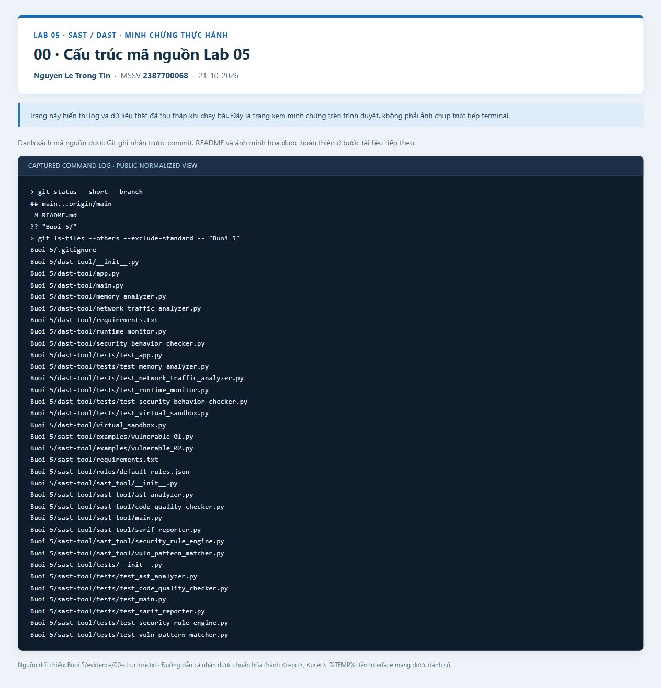

*Hai project SAST và DAST được đặt trong `Buoi 5`, cùng README, ảnh minh họa và dữ liệu thực hành.*

### Luồng SAST

`main.py` đọc file Python → AST và regex tìm các dấu hiệu → `flake8` kiểm tra chất lượng mã → bộ luật gán mức độ → xuất SARIF.

| Thành phần | Vai trò thực tế |
| --- | --- |
| `ASTAnalyzer` | Duyệt cây cú pháp, ghi nhận lời gọi `eval`, `exec` và lỗi cú pháp. |
| `VulnPatternMatcher` | Tìm phép gán mật khẩu dạng chuỗi và import `pickle` bằng biểu thức chính quy. |
| `CodeQualityChecker` | Gọi `flake8` bằng đúng Python đang chạy, đọc mã lỗi, dòng và cột. |
| `SecurityRuleEngine` | Đọc `rules/default_rules.json`, kết hợp phát hiện và gán severity. |
| `SarifReporter` | Dùng thư viện chuẩn `json` tạo báo cáo SARIF 2.1.0 có rule, message, vị trí file/dòng/cột. |
| `main.py` | Nhận file cần phân tích và tùy chọn `--output`; mặc định ghi `report.sarif`. |

Dependency ngoài thư viện chuẩn của SAST chỉ có **`flake8`**. Bản triển khai dùng `json` có sẵn trong Python để tạo SARIF, khác cách dùng `sarif-om`/`jsonpickle` trong tài liệu PDF. Hai gói đó không được import và không cần cài để chạy bản code này.

Các phát hiện là tín hiệu cần xem lại trong mã nguồn. Import `pickle` chưa chứng minh chương trình giải tuần tự dữ liệu không tin cậy; lint cũng không tự chứng minh lỗ hổng bảo mật.

### Luồng DAST

CLI và Flask gọi chung các module hỗ trợ; dữ liệu được in ra terminal hoặc trả về JSON.

| Thành phần | Vai trò thực tế |
| --- | --- |
| `RuntimeMonitor` | Dùng `psutil` đọc CPU, RSS tính bằng byte và danh sách file đang mở của PID được chỉ định. CLI theo dõi chính tiến trình CLI; API theo dõi tiến trình Flask. |
| `MemoryAnalyzer` | Chạy garbage collector, trả số đối tượng đã thu gom/không thu gom được; so sánh số nguyên với giới hạn số nguyên có dấu 64 bit. |
| `NetworkTrafficAnalyzer` | Đọc bộ đếm I/O tích lũy theo từng interface bằng `psutil.net_io_counters(pernic=True)`. |
| `SecurityBehaviorChecker` | Đọc file nguồn, dùng regex tìm chuỗi gọi `os.system`, `eval`, `exec`; không theo dõi lời gọi hệ thống lúc chạy. |
| `VirtualSandbox` | Chỉ chấp nhận câu lệnh demo bắt đầu bằng `echo`, trả phần văn bản; không mở shell hay chạy chương trình hệ điều hành. |
| `main.py` | Chạy lần lượt các ví dụ trên và in kết quả. |
| `app.py` | Cung cấp năm endpoint Flask tại `127.0.0.1:5000`, tắt debug. |

Tên `VirtualSandbox` là tên module của bài: thư mục tạm được tạo trong lúc xử lý, nhưng **không cung cấp cơ chế cô lập ở mức hệ điều hành**. Bộ đếm GC không phải kết luận phát hiện rò rỉ bộ nhớ tổng quát. Python hỗ trợ số nguyên lớn; `check_overflow(2**64)` trả `True` vì giá trị vượt biên signed 64 bit, không phải Python vừa xảy ra tràn số. Module mạng không bắt gói tin và không giải mã nội dung lưu lượng.

## Chuẩn bị trên Windows PowerShell

Cần Git và Python 3.12. Nếu chưa có repository trên máy:

```powershell
git clone https://github.com/Tindaptrai/2387700068_NguyenLeTrongTin.git
cd .\2387700068_NguyenLeTrongTin
```

Nếu đã clone, mở PowerShell tại thư mục gốc repository hiện có. Đặt biến đường dẫn dùng trong các bước sau:

```powershell
$repo = (Get-Location).Path
$lab = Join-Path $repo 'Buoi 5'
py -3.12 --version
```

Chạy lần lượt từng lệnh, đợi lệnh trước hoàn tất. Không cần kích hoạt `Activate.ps1`: các lệnh gọi trực tiếp Python trong `.venv`, tránh phụ thuộc Execution Policy của PowerShell.

## 1. Cài môi trường SAST

Từ PowerShell đã chuẩn bị:

```powershell
Set-Location (Join-Path $lab 'sast-tool')
py -3.12 -m venv .venv
.\.venv\Scripts\python.exe -m pip install -r requirements.txt
```

`requirements.txt` cài `flake8` và các dependency của nó. Nếu tạo `.venv` thất bại, xử lý lỗi tại bước tạo môi trường trước khi chạy pip.

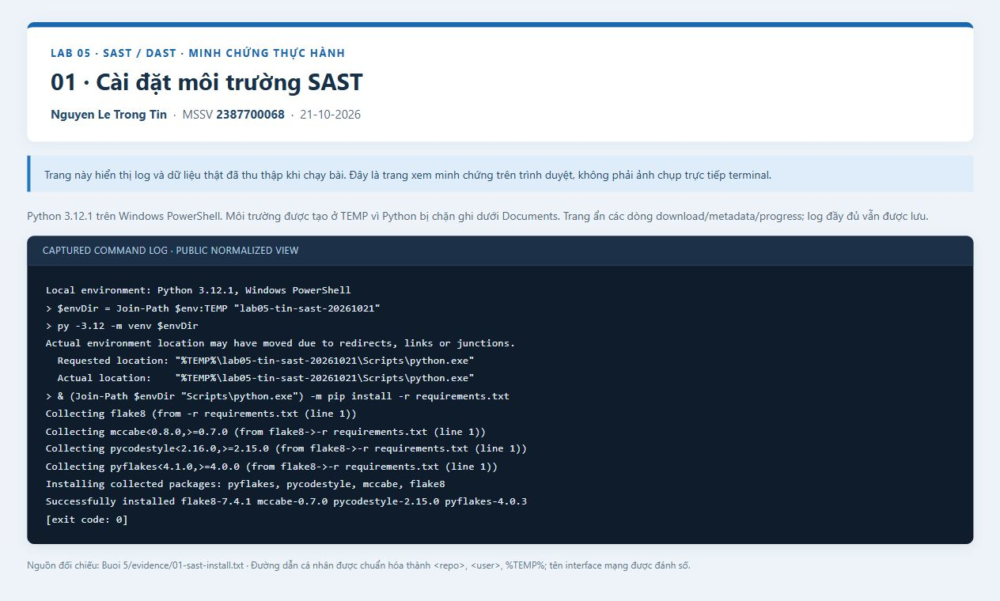

*Log ghi nhận phiên bản Python và cài dependency của project SAST.*

## 2. Chạy kiểm thử SAST

Đứng trong `Buoi 5\sast-tool`:

```powershell
.\.venv\Scripts\python.exe -m unittest discover -s tests -v
```

Các test kiểm tra AST, regex, tích hợp `flake8`, bộ luật severity, báo cáo SARIF và CLI với đường dẫn output tùy chọn. Bộ kiểm thử dùng `unittest` của Python, không cần cài `pytest`. Lần chạy minh họa ghi nhận **10 test thành công**.

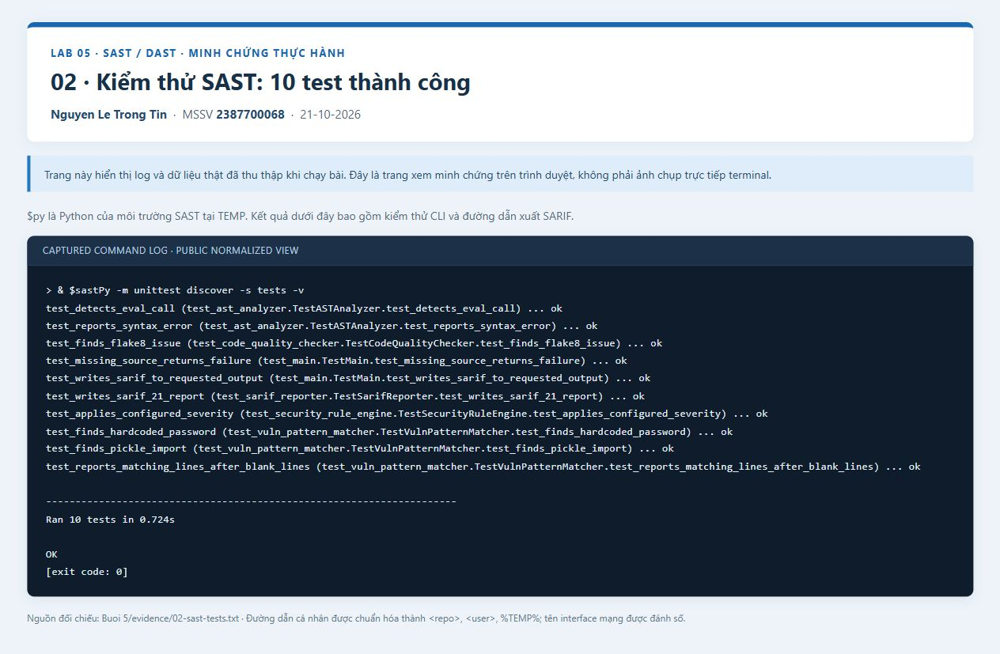

*Đọc dòng tổng kết số test và `OK` ở cuối log để xác nhận kết quả.*

## 3. Phân tích file Python bằng SAST

Trong `sast-tool`, chạy file mẫu và chỉ rõ nơi lưu báo cáo:

```powershell
.\.venv\Scripts\python.exe -m sast_tool.main .\examples\vulnerable_01.py --output .\report.sarif
```

Có thể bỏ `--output .\report.sarif` để dùng tên mặc định. Chương trình in số phát hiện và đường dẫn báo cáo; số phát hiện có thể thay đổi khi mã mẫu hoặc phiên bản `flake8` thay đổi. Mã nguồn được đọc để phân tích, không được thực thi bởi scanner.

Để phân tích mẫu thứ hai và giữ báo cáo riêng trong thư mục tạm:

```powershell
.\.venv\Scripts\python.exe -m sast_tool.main .\examples\vulnerable_02.py --output (Join-Path $env:TEMP 'lab05-report-02.sarif')
```

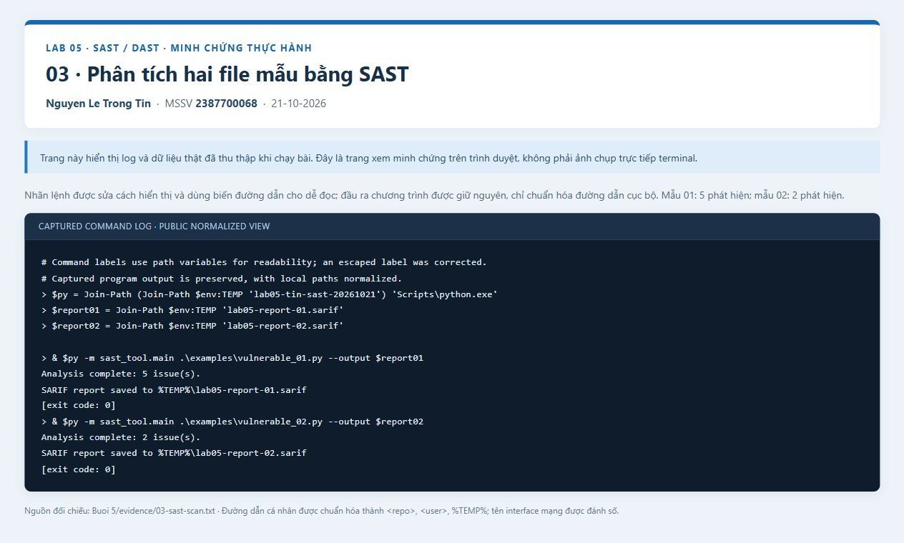

*Log thể hiện lệnh phân tích, số phát hiện thực tế và đường dẫn SARIF của lần chạy.*

## 4. Đọc báo cáo SARIF

Đọc báo cáo của mẫu thứ nhất:

```powershell
$report = Get-Content -LiteralPath .\report.sarif -Raw | ConvertFrom-Json
$report.version
$report.runs[0].tool.driver.name
$report.runs[0].results | Select-Object ruleId, level, @{Name='Line'; Expression={$_.locations[0].physicalLocation.region.startLine}}, @{Name='Message'; Expression={$_.message.text}} | Format-Table -Wrap
```

Báo cáo có `version` là `2.1.0` và tên công cụ `Lab05-SAST`. Mỗi kết quả có `ruleId`, `level`, `message` và vị trí nguồn. Severity `high`, `medium`, `low` lần lượt được xuất thành `error`, `warning`, `note`. URI của file nguồn có thể là đường dẫn tuyệt đối của máy chạy; kiểm tra và chuẩn hóa trước khi chia sẻ báo cáo công khai.

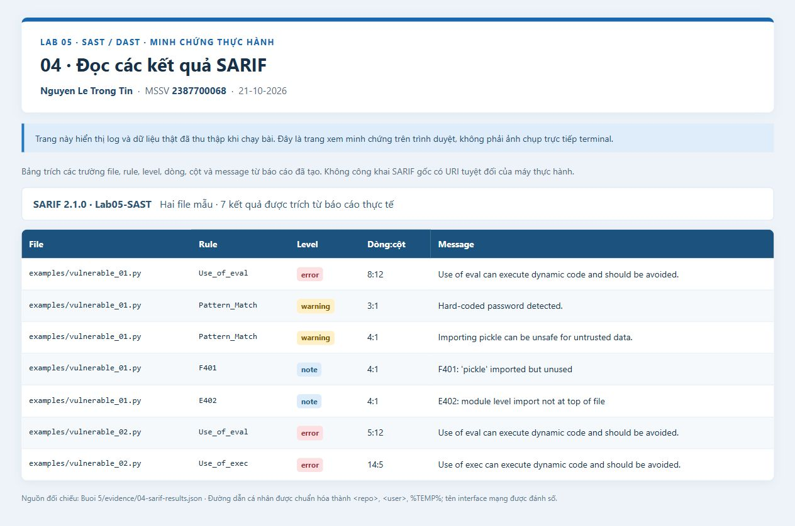

*Trang xem báo cáo trình bày các trường trích từ JSON SARIF, gồm rule, mức độ và vị trí phát hiện.*

## 5. Cài môi trường DAST

Mỗi project có môi trường riêng. Trong PowerShell đang dùng biến `$lab`:

```powershell
Set-Location (Join-Path $lab 'dast-tool')
py -3.12 -m venv .venv
.\.venv\Scripts\python.exe -m pip install -r requirements.txt
```

`requirements.txt` của DAST gồm `psutil` và `Flask`.

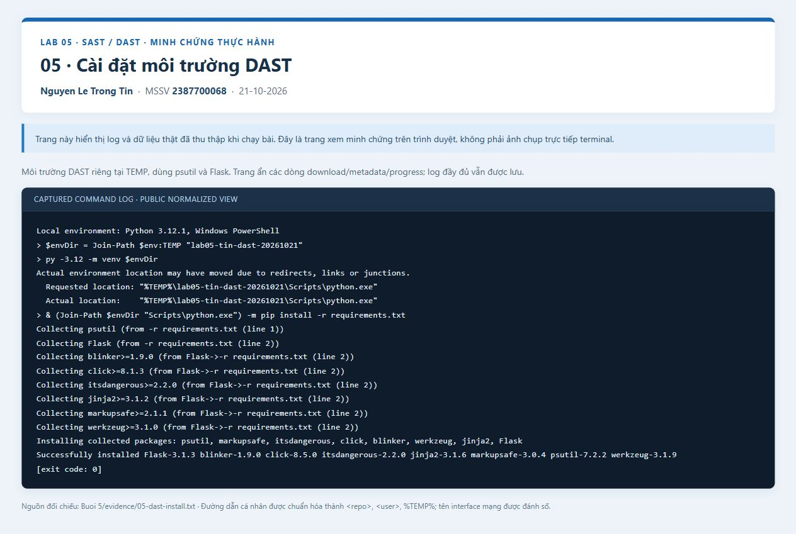

*Log cài môi trường DAST riêng với môi trường SAST.*

## 6. Chạy kiểm thử DAST

Đứng trong `Buoi 5\dast-tool`:

```powershell
.\.venv\Scripts\python.exe -m unittest discover -s tests -v
```

Các test kiểm tra dữ liệu monitor, giới hạn số nguyên, bộ đếm mạng, regex nguồn, echo và xử lý JSON của API sandbox. Lần chạy minh họa ghi nhận **12 test thành công**. API kiểm tra cả JSON sai định dạng, JSON không phải object, thiếu command và command không được phép.

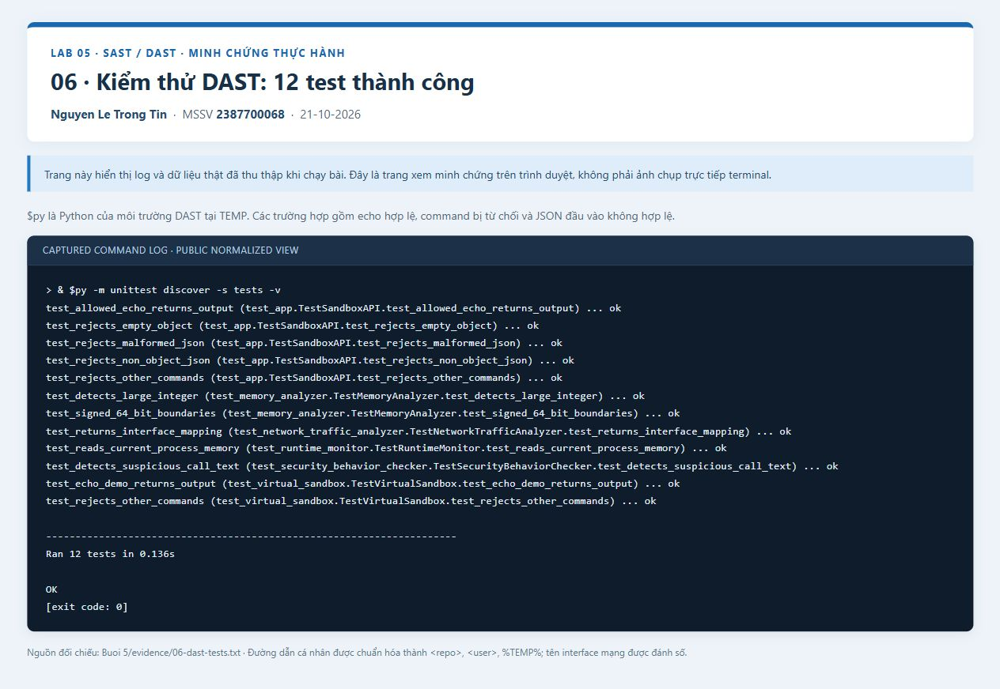

*Dòng `OK` xác nhận bộ kiểm thử hoàn tất trong lần thực hành.*

## 7. Chạy DAST từ CLI

Trong `dast-tool`:

```powershell
.\.venv\Scripts\python.exe .\main.py
```

CLI in PID hiện tại, CPU, RSS, file đang mở, kết quả GC, kiểm tra biên 64 bit, bộ đếm mạng, kết quả dò regex và chuỗi `Hello Sandbox`. Giá trị CPU, bộ nhớ, PID và bộ đếm mạng thay đổi theo máy và thời điểm chạy. Danh sách file mở rỗng có thể là kết quả bình thường; đây không phải kết luận tiến trình không truy cập file trong toàn bộ vòng đời.

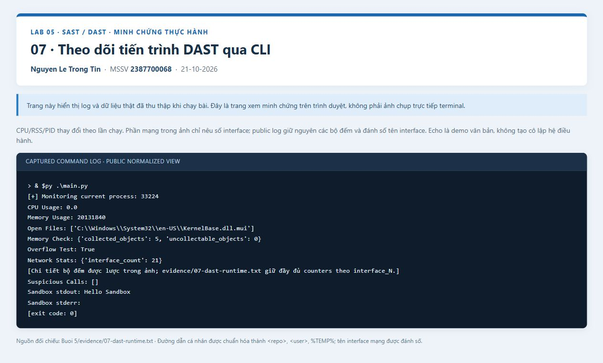

*Log thể hiện dữ liệu của chính tiến trình CLI và kết quả echo demo.*

## 8. Khởi động API Flask

Trong PowerShell thứ nhất, đứng tại `dast-tool` và chạy:

```powershell
.\.venv\Scripts\python.exe .\app.py
```

Giữ cửa sổ này chạy. Server lắng nghe tại <http://127.0.0.1:5000>; ứng dụng không có trang giao diện tại `/`, hãy dùng các đường dẫn `/api/...` bên dưới. Nếu cổng 5000 đã bận bởi bài trước, dừng đúng ứng dụng đang dùng cổng rồi khởi động lại.

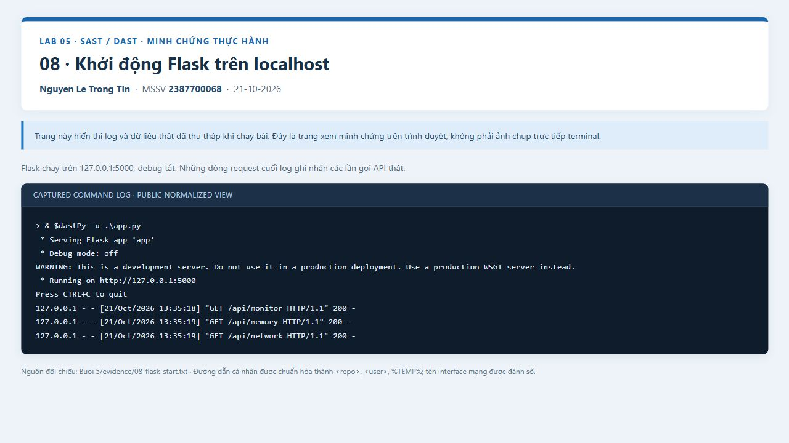

*Log khởi động xác nhận địa chỉ `127.0.0.1:5000` và chế độ debug đã tắt.*

## 9. Gọi các endpoint GET

Mở PowerShell thứ hai. Các lệnh HTTP không yêu cầu đứng trong thư mục project:

```powershell
Invoke-RestMethod -Method Get -Uri http://127.0.0.1:5000/api/monitor | ConvertTo-Json -Depth 8
Invoke-RestMethod -Method Get -Uri http://127.0.0.1:5000/api/memory | ConvertTo-Json -Depth 8
Invoke-RestMethod -Method Get -Uri http://127.0.0.1:5000/api/network | ConvertTo-Json -Depth 8
Invoke-RestMethod -Method Get -Uri http://127.0.0.1:5000/api/security | ConvertTo-Json -Depth 8
```

| Endpoint | Nội dung trả về |
| --- | --- |
| `GET /api/monitor` | CPU, RSS và file mở của tiến trình Flask. |
| `GET /api/memory` | Các bộ đếm GC và kết quả so sánh `2**64` với biên signed 64 bit. |
| `GET /api/network` | Bộ đếm I/O theo interface của máy, không phải chỉ lưu lượng của Flask. |
| `GET /api/security` | Kết quả dò regex trên mã nguồn `app.py`; danh sách rỗng không chứng minh ứng dụng an toàn hoàn toàn. |

Có thể mở trực tiếp <http://127.0.0.1:5000/api/memory> trên trình duyệt để xem JSON. Log phản hồi của cả bốn endpoint nằm trong [evidence/09-api-get.txt](evidence/09-api-get.txt).

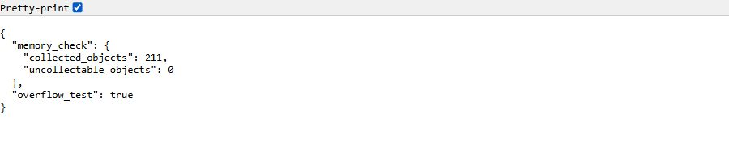

*Ảnh trình duyệt hiển thị phản hồi thật của endpoint memory khi Flask đang chạy.*

## 10. Thử POST sandbox và trường hợp bị từ chối

Trong PowerShell thứ hai, gửi JSON có command echo:

```powershell
$body = @{ command = 'echo Hello Sandbox' } | ConvertTo-Json
Invoke-RestMethod -Method Post -Uri http://127.0.0.1:5000/api/sandbox -ContentType 'application/json' -Body $body | ConvertTo-Json
```

Kết quả mong đợi gồm `stdout` là `Hello Sandbox` kèm ký tự xuống dòng và `stderr` rỗng. Module chỉ xử lý văn bản echo; dấu nối lệnh hay nội dung tương tự được coi là văn bản, không được chuyển cho shell.

Thử command ngoài phạm vi được hỗ trợ:

```powershell
foreach ($command in @('whoami', 'python -V')) {
    $body = @{ command = $command } | ConvertTo-Json
    try {
        Invoke-RestMethod -Method Post -Uri http://127.0.0.1:5000/api/sandbox -ContentType 'application/json' -Body $body
    }
    catch {
        [int]$_.Exception.Response.StatusCode
        $_.ErrorDetails.Message
    }
}
```

Cả hai trường hợp phải trả HTTP **400** và thông báo `Only the echo demo command is allowed.`. Đây là kết quả mong đợi của kiểm tra đầu vào. JSON không phải object hoặc command thiếu/không hợp lệ cũng bị từ chối với HTTP 400. Module Python còn hỗ trợ danh sách token như `["echo", "ok"]`.

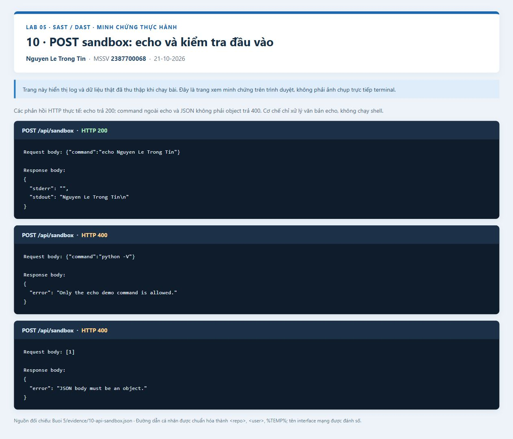

*Log request cho thấy echo trả dữ liệu và command không được hỗ trợ trả HTTP 400.*

Hoàn tất thực hành, quay lại PowerShell thứ nhất và nhấn `Ctrl+C` để dừng Flask.

## Khi Windows chặn ghi trong Documents: môi trường ở TEMP

Phần này là cách thay thế khi `.venv` hoặc báo cáo không ghi được trong thư mục repository. Lần chụp minh họa dùng cách này vì máy thực hành chặn Python ghi dưới `Documents`. Mã nguồn vẫn được chạy tại thư mục project; môi trường và báo cáo nằm trong `%TEMP%`.

Từ PowerShell ở repository root, hoặc dùng lại biến `$lab` đã tạo ở phần chuẩn bị:

```powershell
$sastEnv = Join-Path $env:TEMP 'lab05-tin-sast-20261021'
$dastEnv = Join-Path $env:TEMP 'lab05-tin-dast-20261021'
$sastPy = Join-Path $sastEnv 'Scripts\python.exe'
$dastPy = Join-Path $dastEnv 'Scripts\python.exe'
$env:PYTHONDONTWRITEBYTECODE = '1'
py -3.12 -m venv $sastEnv
py -3.12 -m venv $dastEnv
```

Cài và chạy SAST:

```powershell
Set-Location (Join-Path $lab 'sast-tool')
& $sastPy -m pip install -r requirements.txt
& $sastPy -m unittest discover -s tests -v
$sarifPath = Join-Path $env:TEMP 'lab05-report-01.sarif'
& $sastPy -m sast_tool.main .\examples\vulnerable_01.py --output $sarifPath
Get-Content -LiteralPath $sarifPath -Raw | ConvertFrom-Json
```

Cài và chạy DAST:

```powershell
Set-Location (Join-Path $lab 'dast-tool')
& $dastPy -m pip install -r requirements.txt
& $dastPy -m unittest discover -s tests -v
& $dastPy .\main.py
& $dastPy .\app.py
```

Lệnh cuối giữ server hoạt động; dùng PowerShell thứ hai để gọi API như bước 9–10. Các biến PowerShell chỉ tồn tại trong cửa sổ đã khai báo, vì vậy cần khai báo lại nếu mở cửa sổ mới để chạy Python. Nếu vẫn bị chặn tạo môi trường, kiểm tra quyền ghi hoặc chọn thư mục làm việc mà Python được phép ghi.

## 11. Commit và push lên repository hiện có

Sau khi đã dừng server, về thư mục gốc repository. Kiểm tra danh sách thay đổi trước khi thêm vào commit:

```powershell
Set-Location $repo
git status
git add -- 'Buoi 5' README.md
git commit -m 'feat: add Lab 05 SAST and DAST with illustrated guide'
git push origin main
```

`git add` ở đây thêm cả thư mục Buổi 5 và mục giới thiệu Buổi 5 trong README gốc. `.gitignore` bỏ qua môi trường ảo, cache và tên báo cáo tạm mặc định. Không thêm môi trường ở `%TEMP%` hay file chứa thông tin riêng vào repository.


*Log ghi nhận việc đẩy commit mã nguồn lên nhánh `main`. Ảnh push được chụp sau commit mã nguồn; commit tài liệu tiếp theo bổ sung chính ảnh push và ảnh GitHub vào bài hướng dẫn hoàn chỉnh.*

## 12. Xem bài trên GitHub

Mở [thư mục Buổi 5 trên GitHub](https://github.com/Tindaptrai/2387700068_NguyenLeTrongTin/tree/main/Buoi%205). Kiểm tra có hai project, README và ảnh minh họa; cuộn README để xem hướng dẫn được render. Với một máy mới, clone repository rồi làm theo phần chuẩn bị và các bước cài đặt tương ứng.


*Ảnh trình duyệt xác nhận thư mục Lab 05 đã xuất hiện trong repository GitHub.*

## Lỗi thường gặp

| Hiện tượng | Cách xử lý |
| --- | --- |
| Không tìm thấy Python 3.12 | Chạy `py -0p` để xem Python đã cài; cài Python 3.12 rồi thử `py -3.12 --version`. |
| Không tìm thấy `requirements.txt` hoặc `sast_tool` | Kiểm tra `Get-Location`; chạy lệnh từ đúng `sast-tool` hoặc `dast-tool`. |
| Thiếu `flake8`, `psutil`, `flask` | Chạy pip bằng chính Python của môi trường project; không cài nhầm vào Python hệ thống. |
| `PermissionError` khi tạo môi trường hoặc SARIF | Dùng phương án TEMP bên trên và `--output` trỏ tới nơi được phép ghi. |
| Không kết nối được `127.0.0.1:5000` | Kiểm tra Flask còn chạy, đúng cổng và đúng URL `/api/...`. |
| HTTP 400 tại `/api/sandbox` | Kiểm tra JSON object có `command`; chỉ command echo demo được hỗ trợ. |
| CPU, RSS hoặc thống kê mạng khác ảnh | Đây là dữ liệu tại thời điểm chạy và phụ thuộc máy; không cần trùng giá trị trong ảnh. |

Bài thực hành minh họa một số kỹ thuật phân tích mã và quan sát tiến trình cục bộ. Kết quả cần được đọc theo đúng phạm vi của từng module trước khi dùng để nhận xét về bảo mật hay hiệu năng.