# Buổi 6 – Lab 06: Bảo mật với DevSecOps

- **Sinh viên:** Nguyen Le Trong Tin
- **MSSV:** 2387700068
- **Môn học:** Thực hành Lập trình An toàn Thông tin
- **Chủ đề:** Tích hợp bảo mật vào CI/CD, kiểm thử tự động và quét Infrastructure as Code (IaC)


## 1. Mục tiêu và phạm vi

Bài thực hành đưa các bước kiểm tra bảo mật vào pipeline để phát hiện lỗi trước khi thay đổi được chấp nhận. Demo gồm:

1. **Test và build gate:** chạy unit test và kiểm tra cú pháp Python.
2. **SAST:** Bandit phân tích mã Python để tìm mẫu code nguy hiểm.
3. **SCA:** `pip-audit` đối chiếu dependency với cơ sở dữ liệu advisory.
4. **Secret scanning:** Gitleaks dò token, mật khẩu hoặc secret bị commit.
5. **IaC scanning:** Checkov rà cấu hình Terraform trước khi triển khai.
6. **Security gate:** pipeline chỉ thành công khi tất cả job bắt buộc thành công.
7. **Artifacts:** giữ báo cáo SARIF/JSON để đối chiếu với commit đã quét.

Tài liệu bài học trình bày phần CI/CD bằng GitLab. Vì bài được nộp trong repository GitHub này, demo dùng GitHub Actions để thực thi các gate tương đương. Bài không tạo runner GitLab hay triển khai GitLab Pages/Docusaurus; các job quét và ảnh Actions trong README là từ repository GitHub này.

> **Lưu ý:** Terraform chỉ được quét tĩnh bằng Checkov. Không chạy `terraform apply`, không tạo tài nguyên AWS và không cần khóa cloud.

## 2. Cấu trúc thư mục

```text
.github/
└── workflows/
    └── lab06-devsecops.yml        # Workflow được GitHub nhận tự động
Buoi 6/
├── README.md
├── .gitignore
├── images/                        # Ảnh minh họa các bước thực hành
├── evidence/                      # Log thật dùng đối chiếu ảnh
└── devsecops-demo/
    ├── .gitleaks.toml
    ├── app.py
    ├── requirements.txt
    ├── iac/
    │   └── main.tf
    └── tests/
        └── test_app.py
```

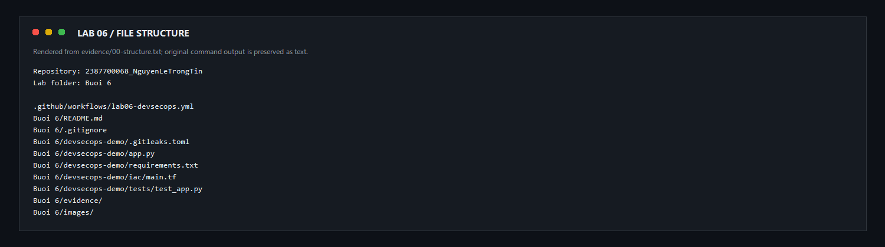

*Khung minh chứng được kết xuất từ danh sách tệp trong `evidence/00-structure.txt`; log gốc được giữ nguyên dưới dạng văn bản.*

## 3. Kiến trúc pipeline

```text
Push / Pull Request thay đổi Buổi 6
                 │
                 ▼
        Unit test + compile check
                 │
      ┌──────────┼───────────┬──────────┐
      ▼          ▼           ▼          ▼
   Bandit    pip-audit   Gitleaks   Checkov
      └──────────┴───────────┴──────────┘
                 │
                 ▼
          Required security gate
                 │
       Tất cả job đều thành công?
          ├── Không: pipeline thất bại
          └── Có: lưu báo cáo và hoàn tất
```

Workflow nằm tại [`../.github/workflows/lab06-devsecops.yml`](../.github/workflows/lab06-devsecops.yml). Nó chạy khi push hoặc pull request có thay đổi trong `Buoi 6/devsecops-demo/`, khi workflow được sửa, hoặc khi được kích hoạt thủ công. Các job quét phụ thuộc vào job test; job cuối kiểm tra trạng thái của tất cả gate.

## 4. Chuẩn bị môi trường cục bộ

Mở PowerShell tại thư mục repository:

```powershell
Set-Location '.\Buoi 6\devsecops-demo'
py -3.12 -m venv .venv
.\.venv\Scripts\python.exe -m pip install -r requirements.txt
.\.venv\Scripts\python.exe --version
.\.venv\Scripts\python.exe -m pip list
```

Các phiên bản dependency của ứng dụng được pin trong `requirements.txt`. `pip-audit` được cài riêng để quét dependency; workflow cài công cụ này trong job SCA. Checkov chạy trong action riêng, tách khỏi môi trường ứng dụng.

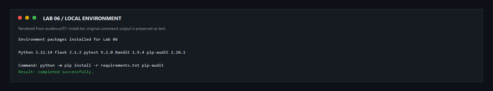

*Khung minh chứng được kết xuất từ log cài đặt trong `evidence/01-install.txt`.*

## 5. Chạy test và compile check

```powershell
.\.venv\Scripts\python.exe -m pytest -q
.\.venv\Scripts\python.exe -m compileall -q app.py tests
```

`test_app.py` gọi endpoint `/api/health`, xác nhận HTTP 200 và JSON báo trạng thái security gate. `compileall` kiểm tra các file Python có thể biên dịch trước khi chạy scanner.

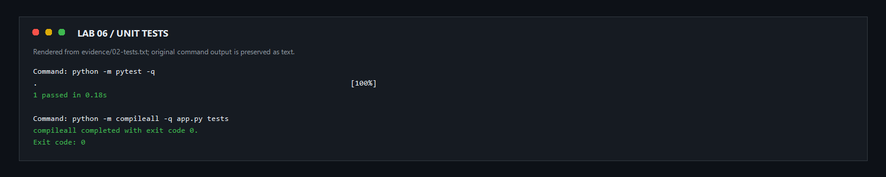

*Khung minh chứng được kết xuất từ kết quả test và compile trong `evidence/02-tests.txt`.*

## 6. SAST với Bandit

```powershell
.\.venv\Scripts\bandit.exe -r app.py -ll
```

Bandit phân tích mã Python và chỉ báo các finding mức trung bình/cao. Workflow cũng xuất `bandit.sarif` thành artifact để có thể xem lại kết quả gắn với commit đã quét.

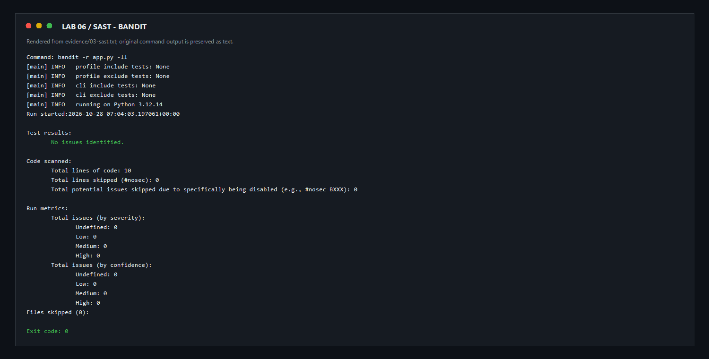

*Khung minh chứng được kết xuất từ log Bandit trong `evidence/03-sast.txt`.*

## 7. SCA với pip-audit

```powershell
.\.venv\Scripts\python.exe -m pip install pip-audit
.\.venv\Scripts\pip-audit.exe -r requirements.txt
```

`pip-audit` so sánh dependency đã khóa trong `requirements.txt` với advisory đã biết. Nếu tìm thấy package có lỗ hổng, job SCA thất bại và báo cáo JSON được tải lên làm artifact. Không bỏ qua CVE để làm pipeline xanh; cần cập nhật package hoặc ghi lại quyết định rủi ro có người review.

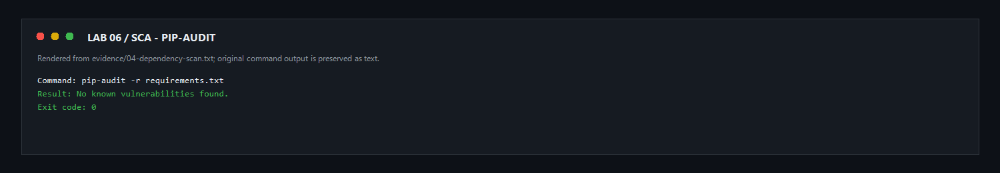

*Khung minh chứng được kết xuất từ log pip-audit trong `evidence/04-dependency-scan.txt`.*

## 8. Secret scanning với Gitleaks

Gitleaks chạy trong GitHub Actions với lịch sử Git được checkout đầy đủ. File `.gitleaks.toml` cấu hình phạm vi loại trừ cho ảnh và log bằng chứng do chúng chỉ chứa dữ liệu minh họa. Không lưu token, mật khẩu, khóa API hay GitHub token vào source. Nếu scanner phát hiện secret thật, cần thu hồi secret trước khi xử lý lịch sử commit.

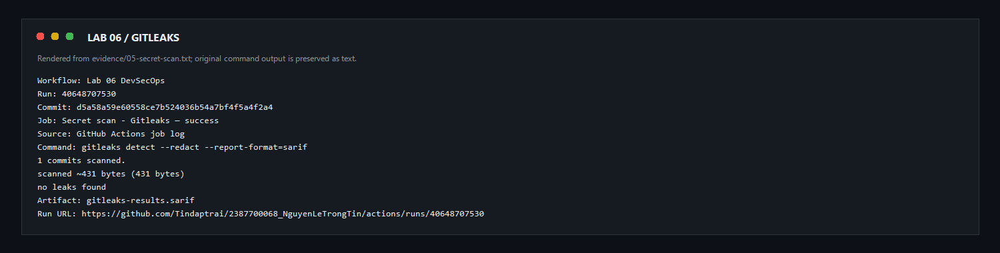

*Ảnh chụp job secret scan thực tế trên GitHub Actions.*

## 9. IaC scan với Checkov

Mở `devsecops-demo/iac/main.tf` để xem các thiết lập mẫu cho bucket:

- chặn ACL và policy công khai;
- mã hóa phía máy chủ bằng KMS;
- bật versioning;
- bật access logging cho bucket dữ liệu;
- xóa artifact/log cũ theo thời hạn;
- dọn multipart upload chưa hoàn tất.

Checkov quét cấu hình nhưng không triển khai AWS resources. Hai kiểm tra được bỏ qua có chủ đích: `CKV2_AWS_62` cần thiết kế event consumer ngoài phạm vi demo; `CKV_AWS_144` yêu cầu bucket và vai trò replication ở region khác. Bucket log cũng được miễn kiểm tra tự ghi access log để tránh tạo vòng lặp log.

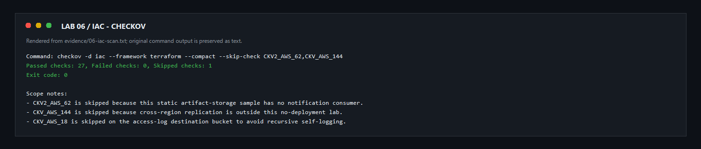

*Khung minh chứng được kết xuất từ log Checkov trong `evidence/06-iac-scan.txt`.*

## 10. Xác minh pipeline trên GitHub

Sau khi push commit:

1. Mở tab **Actions** của repository.
2. Chọn workflow **Lab 06 DevSecOps** và mở run mới nhất.
3. Kiểm tra `Unit tests and compile check`, `SAST`, `SCA`, `Secret scan`, `IaC scan` và `Required security gate`.
4. Mở từng job nếu cần xem log chi tiết.
5. Mở **Artifacts** để tải báo cáo Bandit SARIF, dependency audit JSON và Checkov SARIF.

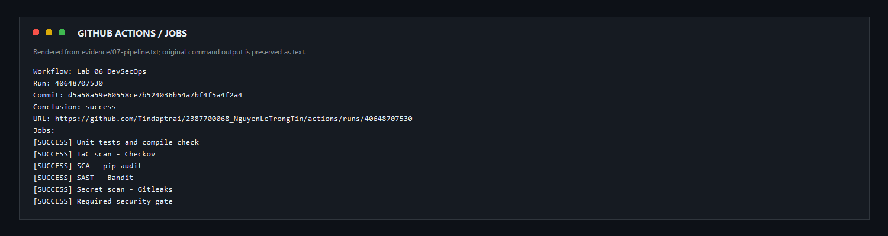

*Các gate được chạy tự động trên cùng một commit; gate cuối chỉ thành công khi các job bắt buộc đều thành công.*

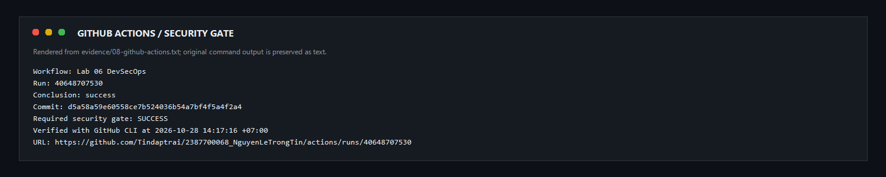

*Ảnh chụp trang run trên GitHub Actions sau khi workflow hoàn tất.*

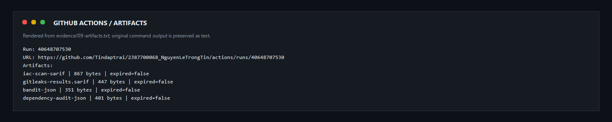

*Ảnh chụp danh sách báo cáo được lưu làm artifacts.*

Artifacts ghi lại kết quả của một lần quét tại một commit cụ thể, không phải cam kết rằng phần mềm tuyệt đối an toàn. Khi review, đối chiếu commit SHA, thời gian chạy, phiên bản công cụ và trạng thái từng job.

## 11. Commit, push và xác minh repository

Từ thư mục repository root:

```powershell
git status --short
git add -- 'Buoi 6' '.github/workflows/lab06-devsecops.yml' README.md
git commit -m 'feat: add Lab 06 DevSecOps pipeline and guide'
git push origin main
git status --short --branch
```

Không commit `.venv/`, báo cáo tạm, token hoặc secret thật. Sau push, kiểm tra thư mục **Buổi 6** hiển thị trên nhánh `main`, ảnh README tải được và Actions run tương ứng đã hoàn tất.

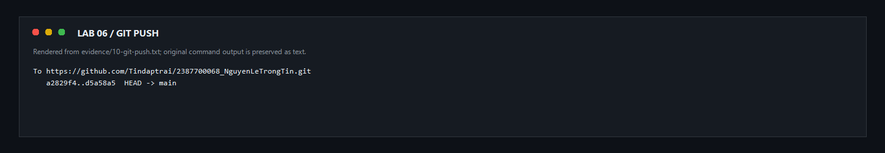

*Khung minh chứng được kết xuất từ log push thực tế; thông tin đăng nhập không được đưa vào ảnh. Log gốc nằm trong `evidence/10-git-push.txt`.*

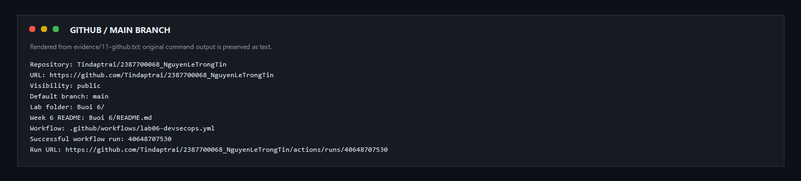

*Ảnh chụp repository sau khi thư mục bài và README đã được đưa lên GitHub.*

## 12. Kết quả kiểm chứng

| Kiểm tra | Kết quả mong đợi | Bằng chứng |
|---|---|---|
| Unit test | Tất cả test pass | `evidence/02-tests.txt` |
| Compile check | Exit code 0 | `evidence/02-tests.txt` |
| Bandit | Không có issue mức Medium/High | `evidence/03-sast.txt` |
| pip-audit | Không có lỗ hổng đã biết trong dependencies | `evidence/04-dependency-scan.txt` |
| Gitleaks | Job secret scan thành công | `evidence/05-secret-scan.txt` |
| Checkov | Không có finding ngoài hai policy được nêu rõ | `evidence/06-iac-scan.txt` |
| GitHub Actions | Required security gate thành công | `evidence/08-github-actions.txt` |
| GitHub push | Commit hiện trên `main` | `evidence/10-git-push.txt` |

Các khung minh chứng bước local được kết xuất từ log lệnh nguyên bản trong `evidence/` để dễ đọc; file `.txt` là bản đối chiếu đầy đủ. Ảnh GitHub Actions, artifacts và repository là ảnh chụp các trang công khai thật của repository.

## 13. Kết luận

Lab 06 minh họa cách kết hợp test, SAST, dependency scanning, secret scanning và IaC scanning thành các chốt bắt buộc trong CI/CD. Khi một job thất bại, pipeline phải dừng để nhóm xử lý finding thay vì triển khai thay đổi chưa được kiểm tra.